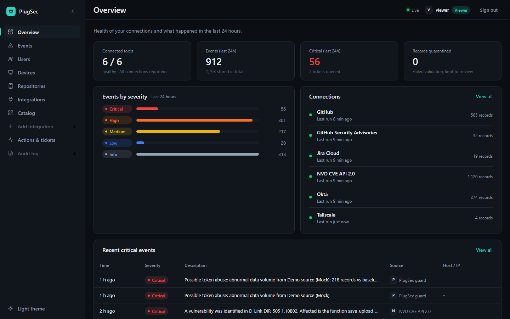
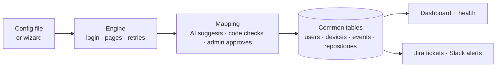

<div align="center">


# PlugSec

**Connect any security tool with config, not code.**

</div>



## The problem

Security teams use many tools: firewalls, Okta, GitHub, Jira, cloud consoles.
Each one has its own login, its own API, its own paging style and its own data format.

So every new tool needs custom code. It takes weeks, it breaks when the vendor changes its API, and every integration fails in a different way.

Integration keys are also a target: in 2025, stolen integration tokens (Salesloft Drift) exposed data at hundreds of companies.

## The solution

**One engine, many configs.**

- A tool is a **small YAML file**, or a form in the **Add integration** wizard. No new code.
- One engine runs every config the same way: log in, fetch every page, retry, map, check, store.
- Every tool's data lands in **one common format**: users, devices, events, repositories.
- Every connection is **safe and reliable by default**: encrypted secrets, retries, rate limits, quarantine, health and alerts.

## How it works



1. **Describe the tool:** where it is, how to log in, which endpoints, how pages work.
2. **Map the fields:** AI suggests which tool field goes where, code checks every suggestion against real data, an admin approves.
3. **Engine runs it on a schedule:** fetches all pages, retries on errors, waits on rate limits.
4. **Convert:** every record becomes a row in one of four common tables, with one time format and one severity scale.
5. **Show and act:** dashboard, health per tool, Jira tickets for serious events, Slack alerts when a tool keeps failing.

## What makes it different

| | |
|---|---|
| **It protects itself** | If a tool suddenly pulls more than 5× its normal data (like a stolen key would), PlugSec pauses it, raises a critical alert and opens a Jira ticket. |
| **AI you can trust** | AI only suggests mappings. Code verifies every field and an admin approves. A rule-based fallback works offline. |
| **Secrets are never exposed** | Configs only name secrets (`${github_token}`). Values are encrypted in a vault, masked in logs and never in Git. |
| **One tool, many endpoints** | One login, several endpoints, each with its own mapping. A `for_each` option calls an endpoint once per record (e.g. per repository). |

## Connected tools

Real APIs, each with a different login and paging style:

| Tool | What it brings | Login | Paging |
|---|---|---|---|
| **GitHub** | Repositories, languages, READMEs, Dependabot alerts, users | Bearer token | Link header |
| **Okta** | Users and sign-in events | API token (`SSWS`) | Link header (cursor) |
| **Jira Cloud** | Users and issues | Basic (email + token) | Offset |
| **NVD** | CVEs with CVSS severity | Optional API key | Offset |
| **Tailscale** | Real devices, online status, new-device events | Bearer token | None |
| **CISA KEV** | Known exploited vulnerabilities (added live in the demo) | None | None |

A labelled **Demo source (Mock)** is used only to trigger failures on demand. Its data never appears on the live pages.

The **Catalog** page covers 35 more security tools (SIEM, EDR, DLP, firewall, cloud) with config templates and what each one still needs.

## Quick start

You need **Python 3.11+**.

```bash
git clone https://github.com/Santhosh121805/Code-driven-Aura-.git
cd Code-driven-Aura-

python -m venv .venv
# Windows: .venv\Scripts\activate      Mac/Linux: source .venv/bin/activate

pip install -r requirements.txt
cp .env.example .env        # fill in keys only for the tools you want
python run_all.py
```

Open **http://localhost:8000** and sign in. The first run prints the admin, analyst and viewer sign-ins once.

## Add a tool in 2 minutes

Save this as `configs/integrations/cisa_kev.yaml`, or build the same thing in the **Add integration** wizard:

```yaml
name: cisa_kev
display_name: "CISA KEV"
base_url: "https://www.cisa.gov"
auth: { type: none }                    # public feed, no login
schedule_seconds: 900                   # every 15 minutes
streams:
  - name: kev
    entity: event                       # goes into the events table
    endpoint: "/sites/default/files/feeds/known_exploited_vulnerabilities.json"
    records_path: "vulnerabilities"     # where the list is in the response
    mapping:                            # our field: field in the tool's data
      id: "cveID"
      type: "'vulnerability'"
      severity: "knownRansomwareCampaignUse"
      timestamp: "dateAdded"
      description: "vulnerabilityName"
    transforms:
      severity_map: { Known: critical, Unknown: high }
```

It goes live without a restart.

## Common format

| Table | Main fields |
|---|---|
| **users** | id, name, email, status, last_login |
| **devices** | id, hostname, ip, os, owner, last_seen |
| **events** | id, type, severity, timestamp, description, host, ip, user |
| **repositories** | name, description, languages, topics, visibility, alerts |

Every row also keeps `source` (which tool), `fetched_at` (when) and the original raw record.
Severity is always one of: critical, high, medium, low, info.

## Reliability

- Network or server errors: retry after **1 s, 2 s, 4 s**, then mark the run as failed.
- Wrong key: **no retry**, shown as "Authentication failed".
- Rate limits: wait as long as the API's `Retry-After` says.
- Broken records: **quarantined** with the reason; the rest is saved.
- Every tool shows its **health**: status, last run, records, last error.
- After 3 failures in a row: **one Slack alert**, then a "recovered" message.

## Security

- Secrets are **named** in configs and **encrypted** in a vault.
- Secret values are **masked** in logs, errors and alerts.
- `.env`, the database and logs are **git-ignored**.
- **Rotate** warning after 90 days; **Revoke** wipes a secret in one click.
- **Roles:** Viewer (read), Analyst (read + run), Admin (everything). The server checks them on every action.
- **Audit log** of every sign-in and change.

## Tech stack

Python · FastAPI · SQLite · httpx · pydantic · JMESPath · APScheduler · Fernet encryption · plain HTML/JS

Run the automated tests with `python -m pytest` (they use fake APIs, never real ones).

## Project structure

```
integration_platform/   the app: engine, mapping, vault, API and web UI
configs/                tool configs (integrations/) and alert rules (actions/)
catalog/                templates and notes for 35 more security tools
tests/                  automated tests
docs/                   full documentation and images
run_all.py              one command to set up and start everything
```

## Limitations and next steps

- **SQLite** for now; **PostgreSQL** for scale.
- Tools are **polled** on a schedule; no push or syslog input yet.
- Some catalog tools need new engine features: **AWS request signing**, **GraphQL paging**, **syslog**.
- Local sign-ins only; no **SSO** yet.

## Documentation

Full docs: [docs/README.md](docs/README.md) · Requirements coverage: [docs/requirements.md](docs/requirements.md)
