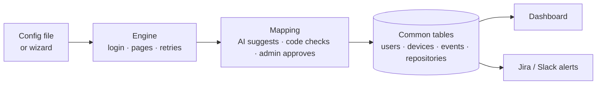

<div align="center">


# PlugSec

**Connect any security tool with config, not code.**


</div>

<br>


<br>

## ✨ What it does

- **Add a security tool with a small config file or a web form**, not code.
- **Every tool's data lands in one format:** users, devices, events, repositories.
- **Safe and reliable by default:** encrypted secrets, retries, rate limits, quarantine, health, alerts.

<br>

## 🔌 How it works



One generic engine runs every config the same way. A new tool is just a new config: no new code, no restart.

<br>

## 🧩 Features

| Feature | What it means |
|---|---|
| **Config, not code** | A tool is a short YAML file (or the Add integration wizard). It goes live in seconds. |
| **Multiple endpoints + for_each** | One tool can call several endpoints, or one call per item (e.g. per repository). |
| **AI-assisted mapping** | AI suggests how fields map; code checks every suggestion; an admin approves it. |
| **One common schema** | Users, devices, events and repositories in the same tables, whatever the source. |
| **Reliable by default** | Retries, rate-limit waits, bad-record quarantine and health status for every tool. |
| **Secret hygiene** | Configs name secrets; values live encrypted in a vault and are masked in logs. |
| **Token-misuse guard** | A sudden jump in pulled data pauses the tool and opens a critical alert. |
| **Roles + audit log** | Viewer, Analyst and Admin roles; every sign-in and change is recorded. |

<br>

## 🛠️ Connected tools

| Tool | What it brings | Login | Paging |
|---|---|---|---|
| **GitHub** | Repositories, languages, READMEs, Dependabot alerts, users | Bearer token | Link header |
| **Okta** | Users and the system log | API key (`SSWS`) | Link header (cursor) |
| **Jira Cloud** | Users and issues | Basic (email + token) | Offset / token |
| **NVD** | CVEs with CVSS severity | Optional API key | Offset |
| **Tailscale** | Devices, online status, new-device events | Bearer token | None |
| **CISA KEV** | Known exploited vulnerabilities (added live in the demo) | None | None |

A clearly labelled **Demo source (Mock)** exists only to show failures on demand (429s, bad records, a bulk export). Live pages never show its data.

<br>

## 🚀 Quick start

You need **Python 3.11+**.

1. Clone the repository.

   ```bash
   git clone https://github.com/Santhosh121805/Code-driven-Aura-.git
   cd Code-driven-Aura-
   ```

2. Create a virtual environment.

   ```bash
   python -m venv .venv
   # Windows: .venv\Scripts\activate    Mac/Linux: source .venv/bin/activate
   ```

3. Install the dependencies.

   ```bash
   pip install -r requirements.txt
   ```

4. Copy the settings file, then fill in values only for the tools you want. Configs refer to them **by name only**.

   ```bash
   cp .env.example .env
   ```

5. Start PlugSec.

   ```bash
   python run_all.py
   ```

6. Open **http://localhost:8000**.

7. Sign in. The first run prints three sign-ins (admin, analyst, viewer) **once**. For a live demo, `DEMO_OPEN_SIGNIN=on` in `.env` accepts any credentials.

<br>

## ⚡ Add a tool in 2 minutes

Save this as `configs/integrations/cisa_kev.yaml`:

```yaml
name: cisa_kev
display_name: "CISA KEV"
base_url: "https://www.cisa.gov"
auth: { type: none }                  # public feed, no login
schedule_seconds: 900                 # pull every 15 minutes
streams:
  - name: kev
    entity: event                     # lands in the events table
    endpoint: "/sites/default/files/feeds/known_exploited_vulnerabilities.json"
    records_path: "vulnerabilities"   # where the list sits in the response
    mapping:                          # common field: path in the tool's data
      id: "cveID"
      type: "'vulnerability'"
      timestamp: "dateAdded"
      description: "vulnerabilityName"
    transforms: { default_severity: high }
```

Or use the **Add integration** wizard: it builds the same file for you, with a test run before saving.

<br>

## 🗂️ Common schema

| Table | Main fields |
|---|---|
| **users** | id, name, email, status, last_login |
| **devices** | id, hostname, ip, os, owner, last_seen |
| **events** | id, type, severity, timestamp, description, host, src_ip, dst_ip, user, resource |
| **repositories** | full_name, description, summary, languages, topics, visibility, stars |

Every row also has `source` (which tool) and `fetched_at` (when it was pulled).

<br>

## 🛡️ Reliability & security

**Reliability**

- Network errors and 5xx: retry after **1 s, 2 s, 4 s**, then mark the run as failed.
- Rate limits: waits for `Retry-After` or the reset header, and slows down early.
- Bad records go to **quarantine** with the reason; the rest of the run is saved.
- Each tool has a **health** status, last run, record counts and last error.
- After 3 failures in a row: **one Slack alert**, plus a banner, then "recovered".

**Security**

- Secrets live in an **encrypted vault** (Fernet). Configs hold only their names, like `${github_token}`.
- Logs **mask** every secret value, tokens and auth headers.
- `.env`, the database and logs are **git-ignored**, and a test checks it.
- **Rotate** warnings by secret age; **Revoke** wipes a secret instantly.
- The **token-misuse guard** pauses a tool that pulls far more data than normal and opens a Jira ticket.

<br>

## 👥 Roles

| Role | Can |
|---|---|
| **Viewer** | Read every page |
| **Analyst** | Viewer + run a tool now |
| **Admin** | Everything: add tools, manage secrets, resume / revoke, demo controls, audit log |

<br>

## ✅ Requirements coverage

| Item | | Where / how |
|---|---|---|
| FR-1 Auth types | ✅ | API key, Bearer, Basic, OAuth2, session |
| FR-2 Endpoints | ✅ | Path, params, headers per endpoint |
| FR-3 Pagination | ✅ | Page, offset, cursor, Link header |
| FR-4 Schedule | ✅ | `schedule_seconds` plus Run now |
| FR-5 Mapping | ✅ | JMESPath, time and severity transforms |
| FR-6 Secrets by name | ✅ | `${name}` resolved from the vault |
| FR-7 Retries | ✅ | 1 s / 2 s / 4 s, then failed |
| FR-8 Rate limits | ✅ | Retry-After, reset headers, pacing |
| FR-9 Bad data | ✅ | Quarantined with a reason |
| FR-10 Health | ✅ | Integrations page status cards |
| FR-11 One store | ✅ | SQLite common tables |
| B-1 Incremental sync | ✅ | `{{ last_sync }}` per endpoint |
| B-2 Config validation | ✅ | Clear errors per wizard step |
| B-3 Test connection | ✅ | Wizard Test step, nothing saved |
| B-4 Repeated-failure alert | ✅ | Slack + banner after 3 failures |
| B-5 Web form to config | ✅ | Add integration wizard, live YAML |

Full mapping to code: [docs/requirements.md](docs/requirements.md).

<br>

## 🧰 Tech stack

Python · FastAPI · SQLite · httpx · pydantic · JMESPath · APScheduler · Fernet · plain HTML/JS

<br>

## 🧪 Tests

`python -m pytest`: **295 tests**, all offline (they never call real APIs or read your `.env`).

<br>

## 📁 Project structure

```
integration_platform/   the app: engine, mapping, vault, API and web UI
configs/                tool configs (integrations/) and alert actions (actions/)
catalog/                research notes and templates for 35 more tools
tests/                  automated tests and fake tools used by them
docs/                   detailed documentation and images
run_all.py              one command to set up and start everything
```

<br>

## 🧭 Limitations & next steps

- **SQLite** is fine for one machine; move to **Postgres** for scale or several instances.
- **Polling only**: tools are pulled on a schedule; no webhook or push receiver yet.
- Some catalog tools need new engine features: **AWS SigV4** signing, **GraphQL / request-body paging**, **syslog** intake, XML APIs.
- Sign-ins are local accounts in `.env`; no **SSO** yet.
- AI mapping suggestions always need an admin to review them.

<br>

## 📚 Docs

Full documentation: [/docs](docs/README.md) (config reference, schema, security, FAQ).
